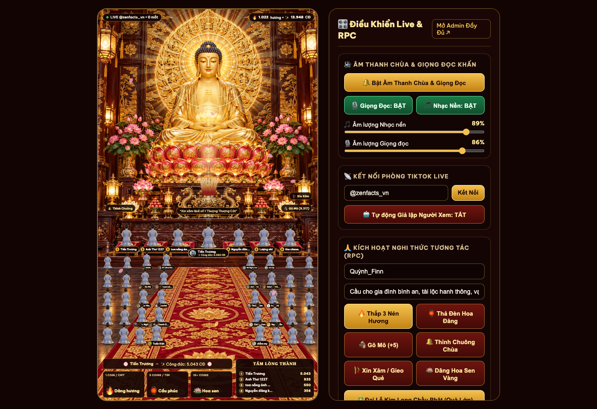
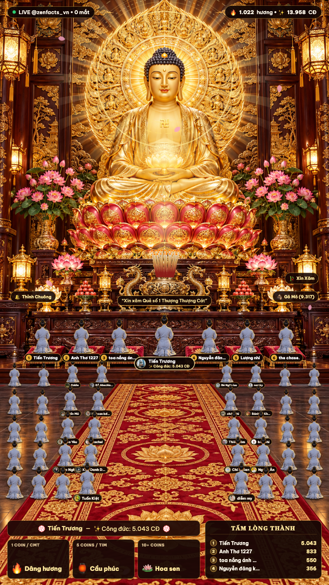
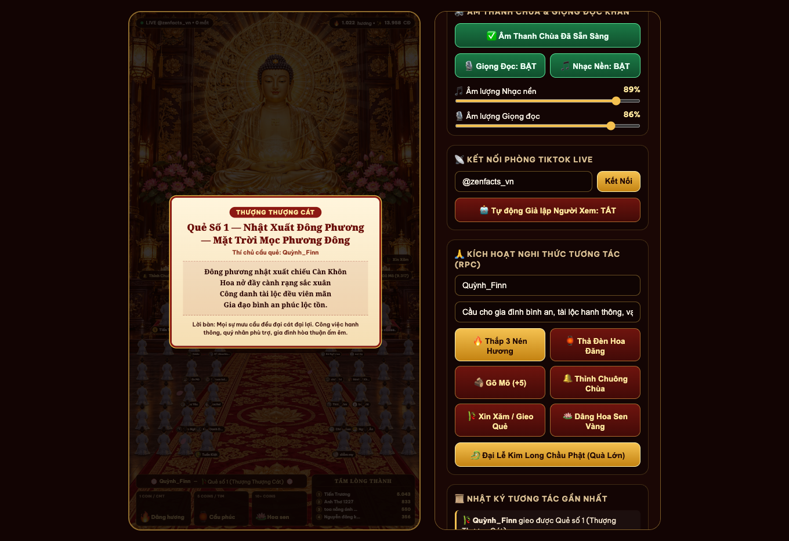
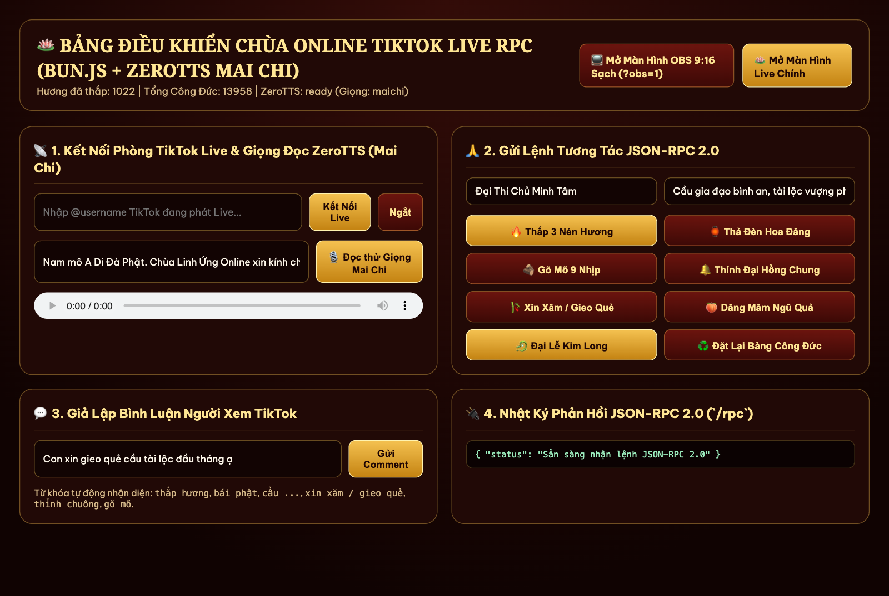

# 🪷 Chùa Linh Ứng Online — TikTok Live RPC (9:16 Interactive Buddhist Sanctuary)

Hệ thống phát trực tiếp tương tác (**Interactive TikTok Live Stream & JSON-RPC 2.0**) chuẩn khung dọc **9:16 (`1080×1920`)** dành cho **OBS Studio / TikTok Live Studio**, chạy siêu nhẹ trên **Bun.js** và tích hợp giọng đọc AI tiếng Việt **ZeroTTS (`zeroweight-ai/ZeroTTS`)** cùng fallback **Web Speech API**.

🌐 **Trải nghiệm trực tiếp trên GitHub Pages**: [https://huytran1120.github.io/live-temple-online/](https://huytran1120.github.io/live-temple-online/)

---

## 🕊️ TUYÊN BỐ MỤC ĐÍCH SỬ DỤNG, ĐẠO ĐỨC & TUÂN THỦ PHÁP LUẬT

Dự án **Chùa Linh Ứng Online** được phát triển với tinh thần nghiêm túc, tôn kính và cầu thị, hướng đến mục tiêu ứng dụng công nghệ đồ họa và trí tuệ nhân tạo để tôn vinh văn hóa truyền thống phương Đông. Mọi cá nhân, tổ chức khi tiếp cận, cài đặt hoặc vận hành mã nguồn này **bắt buộc phải đọc và cam kết tuân thủ** các nguyên tắc dưới đây:

### 1. Tôn Trọng Tuyệt Đối Tín Ngưỡng & Tôn Giáo
- **Mục đích tinh thần & hướng thiện**: Dự án mô phỏng không gian Chánh Điện Đức Phật A Di Đà trang nghiêm, thanh tịnh nhằm mục đích giúp người xem tĩnh tâm, giải tỏa căng thẳng, hướng về các giá trị Chân – Thiện – Mỹ, hiếu kính cha mẹ và lan tỏa tinh thần từ bi, hỷ xả.
- **Không xúc phạm tôn giáo**: Tuyệt đối **KHÔNG** xuyên tạc giáo lý, giễu nhại, báng bổ hình tượng Đức Phật, chư Bồ Tát, Tam Bảo hoặc bất kỳ tôn giáo, tín ngưỡng nào.
- **Không mê tín dị đoan**: Hệ thống xin xăm / gieo quẻ chỉ mang tính chất khuyên răn đạo đức, động viên tinh thần sống tích cực, hướng thiện; hoàn toàn **KHÔNG** mang tính chất bói toán tiêu cực, yểm bùa, phán vận hạn, trừ tà ma hay gieo rắc nỗi sợ hãi cho người dân.

### 2. Tuân Thủ Pháp Luật Nước Cộng Hòa Xã Hội Chủ Nghĩa Việt Nam
Hệ thống được thiết kế để hỗ trợ người dùng tuân thủ đầy đủ các quy định pháp lý hiện hành tại Việt Nam:
- **Luật Tín ngưỡng, Tôn giáo (Số 02/2016/QH14)**: Tôn trọng quyền tự do tín ngưỡng, tôn giáo; nghiêm cấm việc lợi dụng hoạt động tín ngưỡng, tôn giáo để trục lợi, gây mất an ninh trật tự hoặc xâm phạm quyền và lợi ích hợp pháp của tổ chức, cá nhân.
- **Luật An ninh mạng (Số 24/2018/QH14)** và **Nghị định 53/2022/NĐ-CP**: Nghiêm cấm sử dụng không gian mạng để:
  - Tuyên truyền, kích động, chia rẽ khối đại đoàn kết toàn dân tộc hoặc gây hận thù giữa các tôn giáo.
  - Xúc phạm danh dự, nhân phẩm, uy tín của cá nhân, tổ chức.
  - Hoạt động mê tín dị đoan, lừa đảo chiếm đoạt tài sản trên không gian mạng.
- **Nghị định 72/2013/NĐ-CP & Nghị định 27/2018/NĐ-CP**: Tuân thủ quy định về quản lý, cung cấp, sử dụng dịch vụ Internet và thông tin trên mạng, bảo tồn thuần phong mỹ tục của dân tộc Việt Nam.
- **Bộ lọc an toàn tự động tích hợp sẵn**: Hệ thống được cài đặt mặc định bộ lọc ngôn từ chặn đứng các ký tự mã độc, ký tự phá hoại (Cuneiform, Zalgo, Braille flood) và từ ngữ thô tục, phản cảm, xuyên tạc trước khi hiển thị lên màn hình hoặc đưa vào bộ đọc giọng nói.

### 3. Tuân Thủ Tiêu Chuẩn Cộng Đồng Của Nền Tảng (TikTok, YouTube, Facebook Live)
- **Minh bạch & Tương tác chân thực (Authentic Engagement)**:
  - Tính năng Giả lập tự động (**Auto-Sim**) trong mã nguồn chỉ được thiết kế nhằm mục đích **kiểm thử kỹ thuật nội bộ (Internal Testing / Staging)** trong quá trình phát triển. Người vận hành **tuyệt đối KHÔNG** được bật tính năng này trên các phiên phát sóng trực tiếp công khai nhằm mục đích gian lận, thổi phồng lượt tương tác ảo hoặc đánh lừa người xem.
  - Điểm "Công Đức" trên hệ thống là chỉ số tương tác trò chơi hóa (gamification score), hoàn toàn mang giá trị tinh thần trong phạm vi phần mềm, **không có giá trị quy đổi thành tiền mặt, hiện vật hay tài sản ảo**.
- **Nghiêm cấm trục lợi tài chính bất hợp pháp**:
  - Nghiêm cấm việc sử dụng hệ thống để tổ chức quyên góp tiền từ thiện bất minh, bán bùa chú, bán vật phẩm tâm linh giả mạo hoặc yêu cầu người xem tặng quà để "giải hạn, trừ tai ách".
  - Quà tặng (Gifts) trên nền tảng mạng xã hội nếu có phải tuân theo đúng cơ chế tự nguyện và quy định thương mại của từng nền tảng chủ quản.

### 4. Tuyên Bố Miễn Trừ Trách Nhiệm (Disclaimer)
- Dự án này là sản phẩm **mã nguồn mở (Open Source)** phục vụ mục đích học tập, nghiên cứu công nghệ đồ họa nhẹ 2.5D, giao thức JSON-RPC 2.0 và công nghệ tổng hợp giọng nói tiếng Việt bằng trí tuệ nhân tạo.
- Tác giả và những người đóng góp vào kho mã nguồn này **hoàn toàn không chịu trách nhiệm** pháp lý đối với bất kỳ hành vi lạm dụng, sửa đổi mã nguồn hoặc sử dụng phần mềm sai mục đích, vi phạm pháp luật, vi phạm tiêu chuẩn cộng đồng của bất kỳ bên thứ ba nào.

---

## 🎮 Các Nghi Thức Tương Tác Tâm Linh Trang Nghiêm

Người xem trên phiên phát trực tiếp tương tác trực tiếp qua **Bình luận (Comment)**, **Thả tim (Like)**, **Chia sẻ / Follow** và **Tặng quà (Gift)** để thực hiện các nghi thức văn hóa hướng thiện:

- 🔥 **Thắp hương & Đảnh lễ Tam Bái (8-Frame Walking & Prostration)**: Nhân vật Phật tử mặc áo lam bước đi từng bước dọc thảm đỏ hoa sen lên trước Lư Hương Đỉnh Đồng, hạ gối quỳ và thực hiện 3 lạy Ngũ thể đầu địa hướng về Đức Phật A Di Đà.
- 🏮 **Thả Đèn Hoa Đăng / Sớ Cầu Nguyện**: Bình luận lời khấn sẽ bay lên thành Đèn Hoa Đăng kèm giọng đọc AI đọc lời cầu nguyện chúc phúc.
- 🎋 **Xin Xăm / Gieo Quẻ Khuyến Thiện (Đồng bộ Giọng đọc & Tờ Giải Quẻ)**: Tự động lắc ống xăm và mở tờ Giải Quẻ (Thượng Thượng Cát, Đại Cát, Thượng Cát...) mang lời thơ khuyên răn sống lương thiện, giữ tâm bình an.
- 🪵 **Gõ Mõ & 🔔 Thỉnh Đại Hồng Chung**: Thả tim gõ mõ thanh lọc tâm hồn, chia sẻ/follow thỉnh chuông đồng ngân vang lan tỏa năng lượng bình an.
- 📜 **Bảng Vàng Công Đức (`TẤM LÒNG THÀNH` & 6 Đệm Quỳ VIP)**: Vinh danh người xem có điểm tương tác cao nhất trên 6 đệm quỳ gấm đỏ trước bàn thờ Phật.

---

## 📸 Hình Ảnh Demo Giao Diện

### 1. Màn hình Chánh Điện 9:16 & Bảng Điều Khiển Nhanh (`http://localhost:3000`)


### 2. Chế độ OBS Browser Source 9:16 Sạch (`http://localhost:3000/?obs=1`) & Gieo Quẻ Linh Xăm
| Màn hình OBS 9:16 (`?obs=1`) | Tờ Giải Quẻ Linh Xăm (Đồng bộ Giọng Đọc) |
| :---: | :---: |
|  |  |

### 3. Bảng Điều Khiển JSON-RPC 2.0 & Admin (`http://localhost:3000/admin`)


---

## ⚡ Kiến Trúc & Tối Ưu Hóa Hiệu Suất (Siêu Nhẹ CPU/GPU)

- **Runtime**: Chạy trực tiếp trên **Bun.js** (`~0.1% CPU` khi chờ).
- **Canvas Particle Engine (`public/js/particles.js`)**:
  - Khóa tốc độ vẽ ở **30 FPS** ổn định, tự động tạm dừng khi ẩn tab (`document.hidden`).
  - Pre-render toàn bộ Khói hương, Hạt vàng và Cánh hoa sen ra Offscreen Canvas 1 lần duy nhất lúc khởi tạo (`drawImage`), không gọi `createRadialGradient` hay `shadowBlur` trong vòng lặp frame.
- **Zero-Flicker 8-Frame Sprite Stack (`public/js/live.js` & `public/css/live.css`)**:
  - Nạp sẵn cả 8 khung hình chuyển động (`walk1`, `walk2`, `kneelDown`, `kneel`, `forehead`, `bowMid`, `prostrate`, `prostrateDeep`) vào GPU với bóng đổ đã bake sẵn trong PNG, loại bỏ hoàn toàn hiện tượng giật lag khi chuyển tư thế.
- **ZeroTTS AI Worker (`tts_worker.py`)**:
  - Tiến trình Python thường trú nạp model `zeroweight-ai/ZeroTTS` (`intra_op_num_threads=3`, `OMP_WAIT_POLICY=PASSIVE` → **`0.0% CPU` khi chờ**).
  - Tự động chuẩn hóa đỉnh âm lượng (`peak <= 0.90`) và làm mượt hai đầu sóng âm (`cosine fade-in/out`) chống xước/rè tiếng.
  - Tích hợp sẵn cơ chế dự phòng **Web Speech API** khi chạy trên các môi trường tĩnh (GitHub Pages).
- **Bộ Lọc Chặn Ký Tự Lạ & Spam (`server.js` & `tts_worker.py`)**:
  - Chặn tự động các ký tự Cuneiform (`𒐫`), chữ Ả Rập gây lag máy, Braille, Zalgo, bình luận chỉ toàn dấu chấm (`...`) hoặc từ ngữ thô tục, phản cảm.

---

## 🚀 Hướng Dẫn Cài Đặt & Chạy Cục Bộ (Local Workspace)

Tất cả thư viện và môi trường được **cô lập 100% trong thư mục dự án**, không ảnh hưởng đến hệ thống hay các dự án khác trên máy.

### 1. Yêu cầu hệ thống
- [Bun.js](https://bun.sh/) (`>= 1.1`)
- Python `3.10` hoặc `3.11`

### 2. Cài đặt thư viện
```bash
# 1. Cài đặt dependencies Node trong workspace
bun install

# 2. Khởi tạo môi trường ảo Python cục bộ (.venv) và cài đặt ZeroTTS
python3.11 -m venv .venv
.venv/bin/pip install zerotts
```

### 3. Khởi chạy Server
```bash
bun start
# Hoặc chế độ tự động reload khi sửa code:
bun dev
```

Mặc định server chạy tại cổng `3000`:
- **Giao diện Live + Bàn điều khiển nhanh**: [http://localhost:3000](http://localhost:3000)
- **Màn hình OBS Browser Source (9:16 Sạch)**: [http://localhost:3000/?obs=1](http://localhost:3000/?obs=1) *(Kích thước nguồn trong OBS đặt là `1080 × 1920`)*
- **Bảng điều khiển Admin & JSON-RPC**: [http://localhost:3000/admin](http://localhost:3000/admin)

---

## 🎮 Bảng Quy Tắc Tương Tác TikTok Live

| Sự kiện TikTok Live | Điều kiện / Từ khóa | Nghi thức trên Chánh Điện | Ý nghĩa văn hóa / Tinh thần |
| :--- | :--- | :--- | :--- |
| **Thả tim (Like)** | Mỗi đợt thả tim | Gõ mõ gỗ thanh tịnh + Làn sóng Phật tử vái lạy | Tích công đức, thanh lọc phiền não |
| **Follow / Share** | Theo dõi hoặc chia sẻ | Thỉnh Đại Hồng Chung ngân vang + Sóng âm vàng | Lan tỏa năng lượng bình an |
| **Bình luận Thắp hương** | `thắp hương`, `dâng hương`, `bái phật`, `lạy phật` | Phật tử bước dọc thảm đỏ lên Lư Hương, quỳ đảnh lễ 3 lạy + Đọc tên khấn | Lòng thành kính dâng Tam Bảo |
| **Bình luận Cầu nguyện** | `cầu ...`, `nguyện ...`, `nam mô`, `a di đà phật`, `bình an` | Thả Đèn Hoa Đăng bay lên trời + Giọng đọc đọc lời cầu an | Khấn nguyện bình an, cầu siêu cầu an |
| **Bình luận Xin xăm** | `xin xăm`, `gieo quẻ`, `rút quẻ`, `quẻ` | Lắc ống xăm + Mở tờ Giải Quẻ khuyến thiện | Lời khuyên răn đạo đức, giữ tâm an |
| **Tặng quà Nhỏ (1–4 xu)** | Hoa hồng (Rose), Tim... | Dâng Đài Hoa Sen Vàng + Thắp 3 nén hương + Đọc lời cảm tạ | Tri ân công đức |
| **Tặng quà Vừa (5–99 xu)** | Đèn lưu ly, Mâm ngũ quả... | Dâng Đèn Lưu Ly / Mâm Ngũ Quả + Thỉnh Chuông | Cầu trí tuệ sáng suốt, no ấm |
| **Tặng quà Lớn (≥ 100 xu)** | Quà đặc biệt ≥ 100 xu | **Đại Lễ Kim Long Chầu Phật**: Mưa hoa sen vàng, Hào quang vạn trượng | Hoan hỷ đại cát tường |

---

## 🔌 Giao Thức JSON-RPC 2.0 (`POST /rpc` & `ws://localhost:3000/ws`)

Hỗ trợ tích hợp với **TikFinity**, **Streamer.bot**, webhook bên ngoài hoặc gọi trực tiếp bằng `curl`:

```bash
# Thắp hương cầu an
curl -X POST http://localhost:3000/rpc \
  -H "Content-Type: application/json" \
  -d '{
    "jsonrpc": "2.0",
    "id": 1,
    "method": "temple.burnIncense",
    "params": {
      "user": "Thí Chủ Minh Tâm",
      "count": 3,
      "wish": "Cầu gia đình bình an, vạn sự cát tường như ý"
    }
  }'
```

---

## 📁 Cấu Trúc Thư Mục Dự Án

```text
├── server.js                  # Bun.js HTTP + WebSocket JSON-RPC 2.0 Server & TikTok Live Connector
├── tts_worker.py              # Tiến trình Python ZeroTTS thường trú (chống rè, lọc ký tự lạ)
├── data/
│   ├── merit-state.json       # Lưu trữ bền vững dữ liệu tương tác
│   └── tts-cache/             # Bộ đệm file âm thanh WAV đã tổng hợp
├── public/
│   ├── index.html             # Giao diện Chánh Điện 9:16 + Bảng điều khiển nhanh
│   ├── admin.html             # Trang quản trị JSON-RPC 2.0
│   ├── css/live.css           # Stylesheet tối ưu phần cứng GPU Compositor
│   ├── js/
│   │   ├── live.js            # Điều phối chuyển động 8 frame lạy Phật & WebSocket RPC
│   │   ├── particles.js       # 30 FPS Offscreen-Sprite Particle Engine (Khói, Sen rơi, Sóng âm)
│   │   └── audio.js           # Web Audio API mõ/chuông + Hàng đợi ZeroTTS & Web Speech fallback
│   └── assets/                # Hình nền Chánh Điện Đức Phật A Di Đà & bộ khung hình Phật tử áo lam
└── docs/                      # Tài liệu thiết kế kỹ thuật & hình ảnh demo giao diện
```

---

## ⚖️ Giấy Phép (License)
Dự án được phân phối dưới giấy phép mã nguồn mở. Mọi hình thức sao chép, chỉnh sửa hoặc ứng dụng vào thực tế phải tuyệt đối tôn trọng các điều khoản về đạo đức tín ngưỡng, tiêu chuẩn cộng đồng và quy định pháp luật sở tại.
